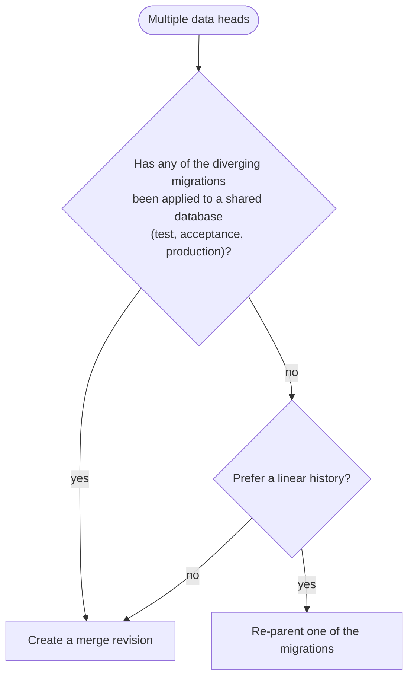

# Managing Diverging Database Migrations

The orchestrator uses [Alembic](https://alembic.sqlalchemy.org/en/latest/) for database migrations. Every migration
points to the migration it builds on through its `down_revision`. As long as every migration has a unique parent, the
migrations form a straight line and Alembic knows exactly what to run.

When two migrations end up with the **same** `down_revision`, the history diverges. This typically happens when
multiple features are developed in parallel and their branches are merged in `git`. This guide explains how the
orchestrator organises its migrations, how to recognise a divergence, and how to resolve it safely.

## How the Orchestrator Organises Migrations

An orchestrator built on orchestrator-core has two independent Alembic branches, identified by their
[branch labels](https://alembic.sqlalchemy.org/en/latest/branches.html#branch-labels):

| Branch   | Owned by           | Location                                               | Contains                                    |
| -------- | ------------------ | ------------------------------------------------------ | ------------------------------------------- |
| `schema` | orchestrator-core  | `orchestrator/core/migrations/versions/schema`         | Core tables, columns, indexes and functions |
| `data`   | your orchestrator  | `migrations/versions/schema` in your orchestrator repo | Products, product blocks, workflows, tasks  |

The first time you run `python main.py db revision`, the orchestrator creates a `create_data_head` migration for you.
It has no `down_revision`, but it carries `branch_labels = ("data",)` and a `depends_on` pointing to the `schema`
head at that moment. Every later migration you create with `db revision` is added on top of `data@head` by default.

```text
<base> --> s1 --> s2 --> s3 --> <head>
        (schema)  ^
                  +--------+ (depends_on)
                           |
                <base> --> d0 --> d1 --> d2 --> <head>
                         (data)

s1  initial schema            d0  create_data_head
s3  latest core migration     d1  add product
                              d2  add workflow
```

!!! note "Two heads is normal"
    Because there are two branches, `python main.py db heads` always shows **two** heads: one for `schema` and one for
    `data`. This is expected and not a divergence. It is also why you upgrade with `db upgrade heads` (plural) instead
    of `db upgrade head`.

    ```
    $ python main.py db heads
    3c8f9a1b2d4e (data) (head)
    f4a7c9e21b08 (schema) (head)
    ```

    The `schema` head is shown as `(effective head)` instead of `(head)` while it is the exact revision the `data`
    branch depends on.

Upgrading orchestrator-core only adds migrations to the `schema` branch. The `data` branch is unaffected, so a core
upgrade on its own never causes a divergence in your migrations.

## How a Divergence Happens

Divergence happens when two people (or two branches) each create a migration on top of the same `data` head:

```text
                 --- feature-a: add dA ---
                /                         \
main: d1 ----->                             ---> main: d1 + dA + dB
                \                         /
                 --- feature-b: add dB ---

dA  add workflow A    down_revision = "d1"
dB  add workflow B    down_revision = "d1"
```

In `git` both branches merge without any conflict, because the two migration files have different names. But both
files contain `down_revision = "d1"`, so the Alembic history is no longer a straight line:

```text
                         --- dA --> <head>
                        /
<base> --> d0 --> d1 -->
         (data)         \
                         --- dB --> <head>

dA  add workflow A    down_revision = "d1"
dB  add workflow B    down_revision = "d1"
```

The `data` branch now has two heads, and `db heads` shows three in total:

```
$ python main.py db heads
dA (data) (head)
dB (data) (head)
f4a7c9e21b08 (schema) (effective head)
```

Commands that need a single `data` head now fail. For example `python main.py db revision` (which targets
`data@head` by default) gives:

```
FAILED: Multiple heads are present; please specify the head revision on which the new revision should be based,
or perform a merge.
```

When starting the orchestrator you may see:

```
Only a single head is supported. The script directory has multiple heads (due branching), which must be resolved by
manually editing the revision files to form a linear sequence. Run `alembic branches` to see the divergence(s).
```

To inspect the divergence in detail, use `python main.py db history --verbose`.

## Resolving a Divergence

There are two ways to bring the `data` branch back to a single head. Which one to choose depends on whether the
diverging migrations have already been applied to a shared database.



### Option 1: Create a Merge Revision

A merge revision is an empty migration with **both** heads as its `down_revision`. It joins the branches back together
without changing any existing migration file, so it is always safe, also for databases that already ran one of the
diverging migrations.

```shell
python main.py db merge dA dB --message "merge feature A and B"
```

This generates a new migration file:

```python
revision = "mg01"
down_revision = ("dA", "dB")
branch_labels = None
depends_on = None


def upgrade() -> None:
    pass


def downgrade() -> None:
    pass
```

```text
                         --- dA ---
                        /          \
<base> --> d0 --> d1 -->            --> mg01 --> <head>
         (data)         \          /
                         --- dB ---

mg01  merge    down_revision = ("dA", "dB")
```

The merge revision inherits the `data` branch label, so `db heads` shows a single `data` head again. A database that
was on `dA` will run `dB` and then `mg01`; a database that was on `dB` will run `dA` and then `mg01`.

!!! warning "Make sure the diverging migrations are independent"
    With a merge revision, the order in which `dA` and `dB` run differs between databases. This is fine as long as the
    migrations do not touch the same rows or objects. If `dB` relies on something `dA` creates, re-parent `dB` instead
    (if it has not been applied anywhere yet), or put the dependent part in a new migration on top of the merge
    revision.

### Option 2: Re-parent a Migration

If none of the diverging migrations has been applied to a shared database yet, for example because the divergence
was caught during code review, you can make the history linear again by pointing one migration to the other. This
is the Alembic equivalent of a `git rebase`.

Pick the migration that should run last (here `dB`) and change its `down_revision` and its `Revises:` docstring to the
other head:

```diff
 """Add workflow B.

 Revision ID: dB
-Revises: d1
+Revises: dA
 Create Date: 2026-10-01 12:00:00

 """
 ...
 revision = "dB"
-down_revision = "d1"
+down_revision = "dA"
```

```text
<base> --> d0 --> d1 --> dA --> dB --> <head>
         (data)

dB  add workflow B    down_revision = "dA"
```

!!! danger "Never re-parent a migration that has already been applied"
    Alembic stores only the current head revision in the `alembic_version` table. If a database is already at `dB` and
    you move `dB` after `dA`, Alembic considers `dA` as applied on that database as well, and `dA` will **never** run
    there. Use a merge revision in that case.

Developers who already applied the old `dB` to their local database should downgrade it before pulling the change
(`python main.py db downgrade d1`), or recreate their local database.

## Do Not Merge the `schema` and `data` Branches

`db merge` accepts any set of revisions, including the special value `heads`. Running
`python main.py db merge heads` while the `data` and `schema` heads are the only heads creates a merge revision that
belongs to **both** branches:

```
$ python main.py db heads
mg02 (data, schema) (head)
```

```text
                      --> s4 --> <head>       (schema)  next orchestrator-core release
                     /
<base> --> ... --> s3 ---
         (schema)        \
                           --> mg02 --> <head>  (data, schema)
                         /
<base> --> ... --> d2 ---
          (data)

mg02  merge heads    down_revision = ("s3", "d2")
s4    new core migration    down_revision = "s3"
```

The `schema` branch now continues in your repository. The next orchestrator-core release adds a migration on top of
the core `schema` head as well, so after upgrading orchestrator-core the `schema` branch has two heads and you need
yet another merge revision. Your orchestrator's migration history and the core history stay entangled from then on.

Always pass the specific diverging `data` revisions to `db merge` instead of `heads`.

## Depending on Core Migrations

Sometimes a `data` migration needs something that is introduced by a core migration, for example a new column. Do
**not** set `down_revision` to the core revision, as that turns the core revision into a parent in your `data` branch
and creates a divergence in the `schema` branch. Use `depends_on` instead:

```python
revision = "d3"
down_revision = "d2"
branch_labels = None
depends_on = "f4a7c9e21b08"  # the core schema revision this migration needs
```

`depends_on` tells Alembic to run the core migration first, without changing the shape of either branch.

```text
<base> --> ... --> f4a7 --> <head>
         (schema)  ^
                   +---------+ (depends_on)
                             |
<base> --> ... --> d2 -----> d3 --> <head>
          (data)

f4a7  f4a7c9e21b08, add column
d3    uses new column    depends_on = "f4a7c9e21b08"
```

## Preventing Divergence

Divergence is easiest to fix before it reaches a shared database. Some ways to catch it early:

- **Check heads in CI.** Fail the pipeline when the `data` branch has more than one head, for example:

    ```shell
    data_heads=$(python main.py db heads | grep -c "(data)")
    if [ "$data_heads" -ne 1 ]; then
        echo "Expected one data head, found $data_heads. Resolve with 'python main.py db merge'."
        python main.py db heads
        exit 1
    fi
    ```

- **Rebase before merging.** When a feature branch that contains a migration is rebased on `main`, check
  `python main.py db heads` and re-parent the migration if needed. At that point it has not been applied to any shared
  database yet, so re-parenting is safe.
- **Keep migrations small and independent.** Independent migrations can be merged safely in any order, which keeps
  the merge revision option open.

## Further Reading

- [Alembic: Working with Branches](https://alembic.sqlalchemy.org/en/latest/branches.html)
- [CLI reference for the `db` commands](../reference-docs/cli.md#db)
- [Backfilling Existing Subscriptions](product-modeling/backfilling.md), an example of writing a `data` migration
